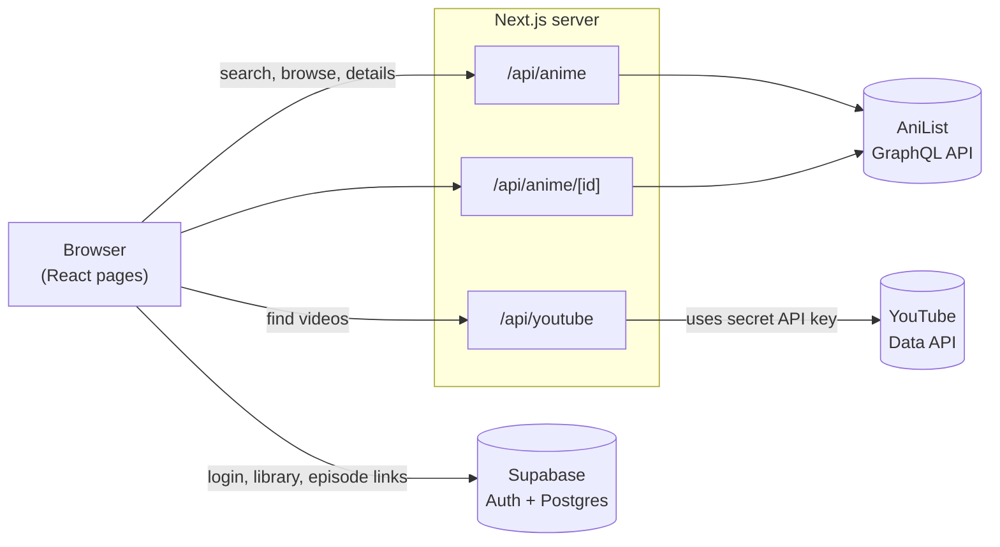
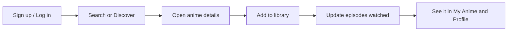
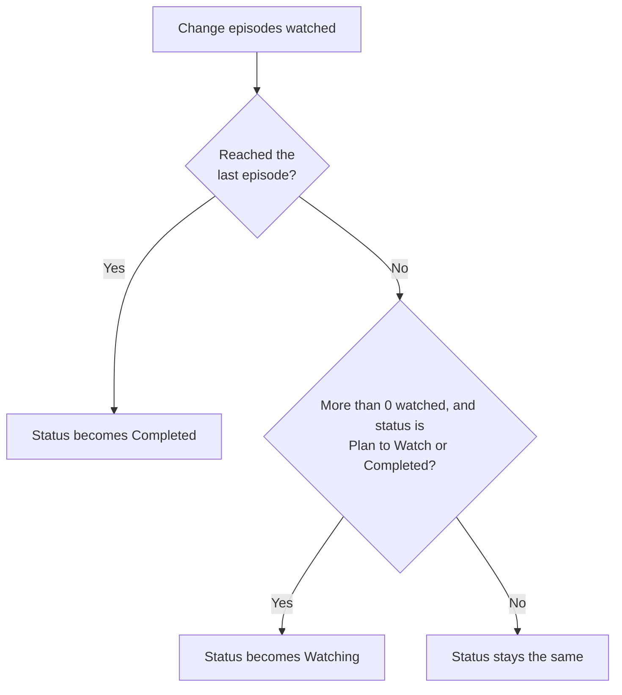

# Anime Tracker

Discover anime, build your own watch list, and track your progress episode by episode.

> **About this project:** This was my first vibe-coded project. I built it to understand how things work, like databases and APIs, just for my own exploration. Expect rough edges.

## Features

- **Discover**: browse anime from AniList, sort by Popular, Trending, Highest Rated or Newest, and filter by genre.
- **Search**: find any title from the home page.
- **Details page**: banner, synopsis, studio, genres, score, episode count, trailer and external links.
- **Personal library**: mark anime as *Watching*, *Completed*, *Plan to Watch* or *Dropped* and update your episode count. The status updates itself as you progress.
- **Episode links**: save your own link for each episode and play YouTube links in an embedded player. Your position in the episode is remembered.
- **YouTube lookup**: finds matching videos, puts official channels first, and filters out reactions, reviews and AMVs.
- **Accounts**: sign up and log in with email and password. Each user sees only their own library.
- **Profile**: stats about your library, like counts by status and top genres.

## Tech stack

| Part | Tool |
| --- | --- |
| Framework | [Next.js](https://nextjs.org) (App Router), React, TypeScript |
| Styling | Tailwind CSS |
| Anime data | [AniList GraphQL API](https://anilist.gitbook.io/anilist-apiv2-docs/) |
| Auth and database | [Supabase](https://supabase.com) (Postgres with Row Level Security) |
| Video search | YouTube Data API v3 |

## How it works

### Architecture



### User flow



### Library status rules

Updating the episode count also changes the status automatically.



Only anime IDs are stored in my database. Titles and covers are fetched from AniList when needed, so nothing goes stale.

## Project structure

```
app/
├── page.tsx              # Home page and search
├── discover/             # Browse and filter
├── anime/[id]/           # Details page and episode links player
├── my-anime/             # Your library
├── profile/              # Stats
├── login/                # Sign up and log in
├── api/                  # anime, anime/[id], anime/batch, youtube routes
└── lib/                  # Supabase client, auth, library logic, shared components
supabase/schema.sql       # Database tables and security rules
```

## Run it locally

1. Install dependencies:
   ```bash
   npm install
   ```
2. Copy `.env.example` to `.env.local` and fill in:
   - `NEXT_PUBLIC_SUPABASE_URL` and `NEXT_PUBLIC_SUPABASE_PUBLISHABLE_KEY` from your Supabase project
   - `YOUTUBE_API_KEY` from Google Cloud (optional, only for the YouTube lookup)
3. Open the Supabase SQL Editor and run [`supabase/schema.sql`](supabase/schema.sql). It creates the `library` and `episode_links` tables and the Row Level Security policies.
4. Start the app and open [http://localhost:3000](http://localhost:3000):
   ```bash
   npm run dev
   ```

## What I learned

**APIs**
- The difference between REST and GraphQL, and how to call both from a server route
- Keeping secret keys on the server: the browser calls my API route, never YouTube directly
- Validating input and handling errors when an outside API fails
- Caching responses to save API quota

**Databases and auth**
- How tables relate to users through `user_id`
- Upsert: insert a row, or update it if it already exists
- Row Level Security: the database itself makes sure users only see their own data
- Email and password login with Supabase sessions

**Next.js and React**
- Pages, dynamic routes like `/anime/[id]`, and API routes in the App Router
- Client vs server components, and loading and error states
- Using `localStorage` for small per-browser data, like remembering where you stopped in an episode

## Credits

Anime data from [AniList](https://anilist.co). Videos via the YouTube Data API.